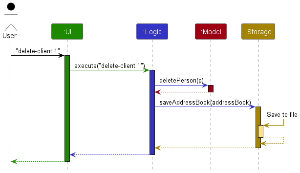
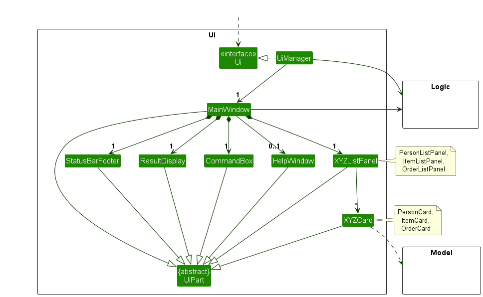
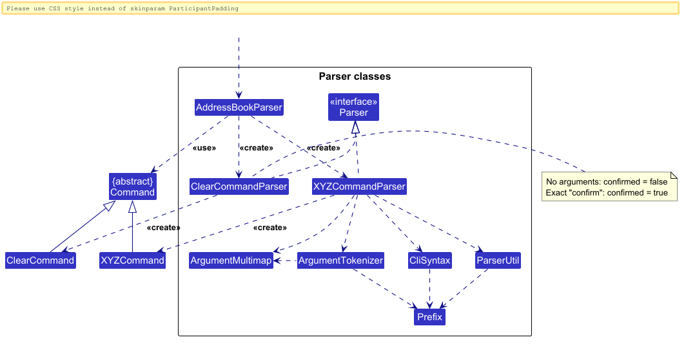
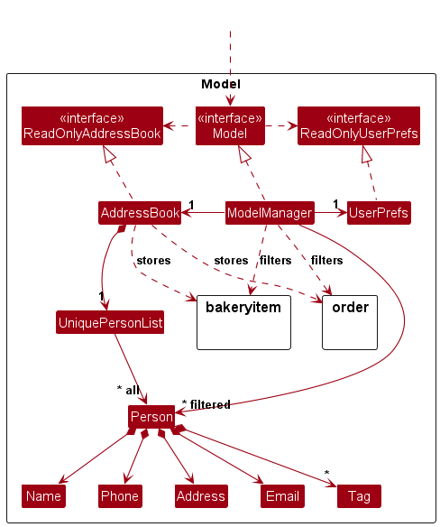
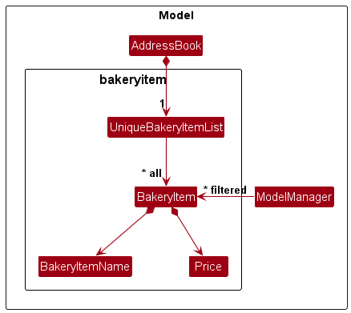
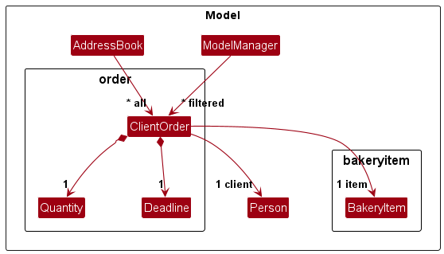
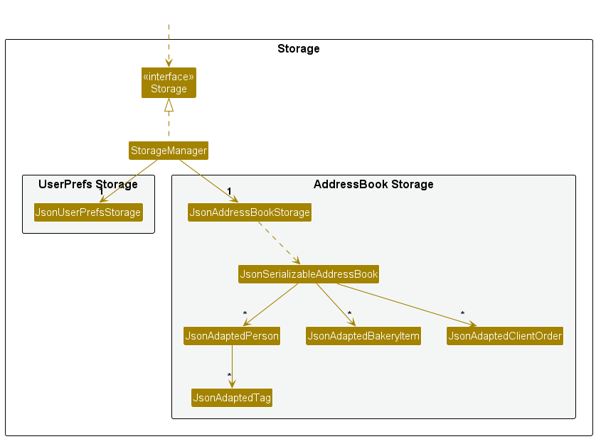
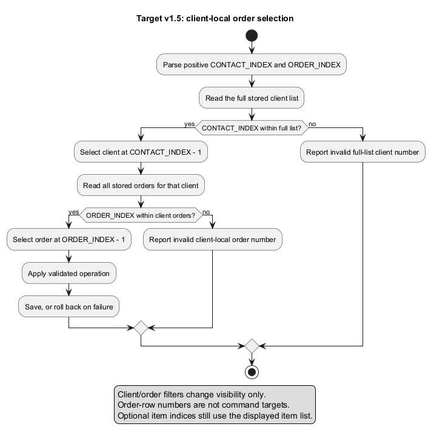
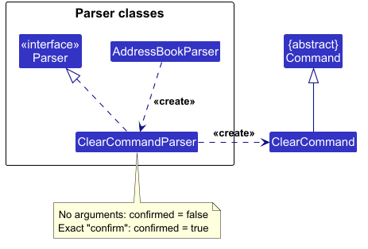

* Table of Contents
{:toc}

<div markdown="block" class="alert alert-warning">

**Target v1.5 client-numbering contract (issue #141):** The full-list position rules in this guide
describe the coordinated migration, not behavior enabled by this documentation-only change.
The current pre-migration implementation uses filtered client positions. Complete and jointly verify
the #142–#149 implementation tasks tracked by [#141](https://github.com/AY2627S1-CS2103T-F14-3/tp/issues/141) before publishing these instructions
with a release. The `mark` alias ([#132](https://github.com/AY2627S1-CS2103T-F14-3/tp/issues/132)) and
`edit-order` ([#133](https://github.com/AY2627S1-CS2103T-F14-3/tp/issues/133)) remain separate deliveries.

</div>

--------------------------------------------------------------------------------------------------------------------

## **Acknowledgements**

* BakeBase is adapted from [AddressBook Level 3 (AB3)](https://github.com/se-edu/addressbook-level3)
  by the [SE-EDU initiative](https://se-education.org/). Its architecture, implementation, tests, and
  documentation provide the foundation for this project.
* Libraries used: [JavaFX](https://openjfx.io/) for the graphical user interface,
  [Jackson](https://github.com/FasterXML/jackson) for JSON serialization, and
  [JUnit 5](https://junit.org/junit5/) for automated testing.

Notable uses of AI:

* Codex was used extensively to generate or update almost all of the code and test cases.
* Codex was used to update most of the DG and UG. This includes the `.puml` files and exported diagrams.
* Codex was used for finding bugs, generating GitHub issues, PRs, and sometimes for PR reviews.

--------------------------------------------------------------------------------------------------------------------

## **Setting up, getting started**

Refer to the guide [_Setting up and getting started_](SettingUp.md).

--------------------------------------------------------------------------------------------------------------------

## **Design**

<div markdown="span" class="alert alert-primary">

:bulb: **Tip:** The `.puml` files used to create diagrams are in `docs/diagrams`. Refer to the [_PlantUML Tutorial_ at se-edu/guides](https://se-education.org/guides/tutorials/plantUml.html) to learn how to create and edit diagrams.
</div>

### Architecture


The ***Architecture Diagram*** given above explains the high-level design of the App.

The following provides a quick overview of the main components and their interactions.

**Main components of the architecture**

**`Main`** (consisting of classes [`Main`](https://github.com/AY2627S1-CS2103T-F14-3/tp/tree/master/src/main/java/seedu/address/Main.java) and [`MainApp`](https://github.com/AY2627S1-CS2103T-F14-3/tp/tree/master/src/main/java/seedu/address/MainApp.java)) is in charge of the app launch and shut down.
* At app launch, it initializes the other components in the correct sequence, and connects them up with each other.
* At shut down, it shuts down the other components and invokes cleanup methods where necessary.

The bulk of the app's work is done by the following four components:

* [**`UI`**](#ui-component): The UI of the App.
* [**`Logic`**](#logic-component): The command executor.
* [**`Model`**](#model-component): Holds the data of the App in memory.
* [**`Storage`**](#storage-component): Reads data from, and writes data to, the hard disk.

[**`Commons`**](#common-classes) represents a collection of classes used by multiple other components.

**How the architecture components interact with each other**

The *Sequence Diagram* below shows how the components interact with each other for the scenario where the user issues the command `delete-client 1`.



For the v1.5 numbering contract, `1` selects the first client in the full stored list, even when
another client is the first search result. This high-level diagram omits index resolution.

Each of the four main components (also shown in the diagram above),

* defines its *API* in an `interface` with the same name as the Component.
* provides its functionality through a concrete `{Component Name}Manager` class that implements the corresponding API interface.

For example, the `Logic` component defines its API in `Logic.java` and implements it in `LogicManager.java`. Other components interact with a component through its interface rather than its concrete class, preventing them from coupling to that component's implementation, as illustrated in the following partial class diagram.


The sections below give more details of each component.

### UI component

The **API** of this component is specified in [`Ui.java`](https://github.com/AY2627S1-CS2103T-F14-3/tp/tree/master/src/main/java/seedu/address/ui/Ui.java)



The UI consists of a `MainWindow` and its parts, such as `CommandBox`, `ResultDisplay`, `PersonListPanel`, and `StatusBarFooter`. All of these, including `MainWindow`, inherit from the abstract `UiPart` class, which captures common behavior among classes that represent visible GUI parts.

The `UI` component uses the JavaFX UI framework. The layouts of these UI parts are defined in matching `.fxml` files in `src/main/resources/view`. For example, [`MainWindow.fxml`](https://github.com/AY2627S1-CS2103T-F14-3/tp/tree/master/src/main/resources/view/MainWindow.fxml) specifies the layout of [`MainWindow`](https://github.com/AY2627S1-CS2103T-F14-3/tp/tree/master/src/main/java/seedu/address/ui/MainWindow.java).

The `UI` component,

* executes user commands using the `Logic` component.
* listens for changes to `Model` data so that the UI can be updated with the modified data.
* keeps a reference to the `Logic` component, because the `UI` relies on the `Logic` to execute commands.
* depends on some classes in the `Model` component because it displays `Person` objects from the model.

For the numbering migration, the UI needs both the filtered observable client list (visible membership)
and the full observable client list (number lookup). `PersonListPanel` and `OrderListPanel` must derive
client labels from the same full list. Order cards always include the client number, even for hidden
clients. Filtering, scrolling/reuse of cells, deletion, undo and data replacement must not leave stale labels.
The UI class diagram above is structural; these numbering responsibilities are implemented in #142/#143.

### Logic component

**API** : [`Logic.java`](https://github.com/AY2627S1-CS2103T-F14-3/tp/tree/master/src/main/java/seedu/address/logic/Logic.java)

Here's a (partial) class diagram of the `Logic` component:


The sequence diagram below illustrates the interactions within the `Logic` component, taking `execute("delete-client 1")` API call as an example.


In the target contract, resolve the parsed position against `model.getAddressBook().getPersonList()`
before calling `deletePerson` with the selected `Person`. A search-result count is not the upper bound.
The full-list selection is detailed in the client-position diagram below; the sequence above summarizes deletion.

<div markdown="span" class="alert alert-info">:information_source: **Note:** The lifeline for `DeleteCommandParser` should end at the destroy marker (X), but due to a limitation of PlantUML, it continues to the end of the diagram.
</div>

How the `Logic` component works:

1. When `Logic` is called upon to execute a command, the command is passed to an `AddressBookParser` object, which in turn creates a parser that matches the command (e.g., `DeleteCommandParser`) and uses it to parse the command.
1. This results in a `Command` object (more precisely, an object of one of its subclasses e.g., `DeleteCommand`) which is executed by the `LogicManager`.
1. The command can communicate with the `Model` when it is executed (e.g. to delete a person).<br>
   Note that although this is shown as a single step in the diagram above for simplicity, the code can require several interactions between the command object and the `Model` to complete the operation.
1. The result of the command execution is encapsulated as a `CommandResult` object which is returned from `Logic`.

Here are the other classes in `Logic` (omitted from the class diagram above) that are used for parsing a user command:



How the parsing works:
* When called upon to parse a user command, the `AddressBookParser` class creates an `XYZCommandParser` (`XYZ` is a placeholder for the specific command name, e.g., `AddCommandParser`). The parser uses the other classes shown above to parse the user command and create an `XYZCommand` object (e.g., `AddCommand`). The `AddressBookParser` returns that object as a `Command` object.
* All `XYZCommandParser` classes, such as `AddCommandParser` and `DeleteCommandParser`, implement the `Parser` interface so they can be treated similarly where appropriate, for example during testing.

### Model component
**API** : [`Model.java`](https://github.com/AY2627S1-CS2103T-F14-3/tp/tree/master/src/main/java/seedu/address/model/Model.java)



The `bakeryitem` package forms the bakery-item subcomponent of the Model component:



The `order` package forms the client orders subcomponent of the Model component.



The `Model` component,

* stores client (represented by `Person`), bakery-item, and order data in unique collections.
* stores the `Person`, `BakeryItem`, and `ClientOrder` objects selected by their current filters in separate _filtered_ lists. It exposes these lists as unmodifiable observable lists that the UI can observe and bind to, so the UI updates when any of these lists changes.
* stores a `UserPrefs` object that represents the user’s preferences (currently, just the GUI settings). This is exposed to the outside as a `ReadOnlyUserPrefs` object.
* does not depend on any of the other three components (as the `Model` represents data entities of the domain, they should make sense on their own without depending on other components)

The `all` and `filtered` associations in the model diagrams have different purposes. Full client-list
order defines client positions, while the filtered client list only defines visibility. The existing
full-book `ReadOnlyAddressBook#getPersonList()` is the source for command resolution. The `Logic` API
must expose a complete observable client source for UI numbering as part of #142/#143; a filtered-list
fallback cannot supply full-list positions. Bakery-item commands continue to use displayed item positions.

<div markdown="span" class="alert alert-info">:information_source: **Note:** The alternative, arguably more object-oriented, design below keeps a unique list of tags in `AddressBook`, and each `Person` references tags from that list. This lets `AddressBook` maintain one `Tag` object per unique tag instead of each `Person` holding its own `Tag` objects.<br>


</div>


### Storage component

**API** : [`Storage.java`](https://github.com/AY2627S1-CS2103T-F14-3/tp/tree/master/src/main/java/seedu/address/storage/Storage.java)



The `Storage` component,
* can save both bakery book data and user preference data in JSON format, and read them back into corresponding objects.
* is implemented by `StorageManager`, which delegates the actual JSON file access to `JsonAddressBookStorage` and `JsonUserPrefsStorage` (one class per data file).
* depends on some classes in the `Model` component (because the `Storage` component's job is to save/retrieve objects that belong to the `Model`)

### Common classes

Classes used by multiple components are in the `seedu.address.commons` package.

--------------------------------------------------------------------------------------------------------------------

## **Implementation**

### Full-list client positions (target v1.5)

Client numbers are 1-based positions in `ReadOnlyAddressBook#getPersonList()`, not persisted IDs.
Filtering never changes that sequence. For full-list clients Alex 1, Bernice 2 and Charlotte 3,
`find-clients bernice charlotte` shows 2 and 3; `find-clients charlotte` shows 3 alone.
Orders for hidden Bernice still show client 2 and remain addressable through `2 o/ORDER_INDEX`.



This activity diagram specifies the migration target. The filtered client list does not participate
in command selection. A position of 3 can be valid when the search has only two results; conversely,
a positive position beyond the full list is invalid even if an old card or command history contains it.

Consumer | Resolution and responsibilities
---------|--------------------------------
`find-clients`, `list-clients` / `PersonListPanel` | Change visible membership; calculate labels from the full list and allow gaps.
`OrderListPanel` / `OrderCard` | Always calculate client labels from the full list, and client-local order numbers from all stored orders for that client. Refresh cached/reused cells after changes.
`AddClientOrderCommand` | Resolve client from the full list and item from the displayed item list; retain the active order view.
`OrderCommandUtil#findOrder()` | Check the client index against the full list, resolve that client, then check the order index against that client's full stored orders.
`DeleteClientOrderCommand`, `MarkOrderCompleteCommand`, `UnmarkOrderCommand` | Share the resolver; active order searches/completion filters do not restrict targets. The `mark` alias, when delivered, must share the same path.
`EditCommand`, `DeleteCommand` | Select from the full client list. Preserve duplicate checks, linked-order updates and referenced-client deletion protection.
`EditClientOrderCommand` (when delivered) | Use the same client/order resolver; resolve optional `i/` from the displayed item list. Retain order UUID, client, completion status and insertion position.

The command parameter names and storage schema do not change for this migration. Client-local order
positions are distinct from order-view row positions; filtering/sorting only changes the latter.
Deleting an order renumbers later orders for that client. Deleting a client renumbers later clients,
requiring both client and order panels to refresh, including rows that were off-screen. Editing a
client does not change its position. Undo restores the snapshot's stored sequence; populate and clear
replace the book, so previously recalled numbers can identify different records or become invalid.
Command history continues to store text rather than record identities.

Save-failure rollback must restore the stored sequence, all active predicates and the order comparator;
the UI must then show labels derived from the restored data. Do not keep a second mutable number map
that can diverge from the authoritative full list. The storage name references and order UUIDs remain
separate from these transient positions; no new permanent numeric client ID is introduced here.

#### Release dependencies and documentation audit

This issue changes documentation and diagram assets only. Before a release advertises this contract:

* Complete #142 (client list) and #143 (all order cards, including scroll/refresh behavior).
* Complete #144–#147 (add/delete/mark/unmark orders) and #148/#149 (edit/delete clients).
* Align #133's `edit-order` implementation when included. Keep #132's alias on the same resolver as marking.
* Update code-owned usage/help strings and errors in those implementation issues. They must explain
  full-list client positions without changing the displayed-item index rule.
* Run the migration manual checks below against the final packaged JAR, including hidden targets,
  client-list gaps, invalid indices, deletion, undo and save-failure rollback.
* Capture a real filtered-view screenshot after #142/#143 are integrated; do not manufacture a screenshot
  of pending behavior. Existing all-clients screenshots remain layout illustrations. The old filtered
  screenshot is no longer embedded in the UG because its numbering contradicts the new contract.
* Coordinate the published UG/DG and release JAR. The older v1.4 release/tag guide remains the reference
  for filtered-index behavior; this branch is not evidence that a new executable has shipped.

Audit scope: the entire UG and DG, their command summaries, numbering examples, backend descriptions,
manual instructions, architecture/model/UI captions and linked guide pages/PlantUML sources were
checked for client-index semantics. The operational changes are in these two guides and the new
resolution diagram. The general setup, documentation, testing, logging and DevOps pages contain no
alternative client-index contract; the testing guide links to the migration checks for release QA.

### Clear confirmation

The following class diagram shows how clear-command parsing stores the
confirmation choice in a `ClearCommand`.



`ClearCommandParser` accepts only no arguments or the exact token `confirm`. An unconfirmed `ClearCommand` throws a `CommandException` containing the warning before modifying the model. This also prevents the normal save path from running. A confirmed command clears the complete bakery book and resets client/item filters; the existing logic-layer save rollback restores data and filters if persistence fails.

The confirmation is explicit in `clear confirm`, with no pending state or dialog. It is a one-shot command for experienced users and executes even without an earlier `clear`; there is no additional confirmation. Users cancel an unconfirmed request by continuing with another command. Both the warning and Help usage explicitly state that `clear confirm` deletes all clients, items, and orders immediately.

The warning formats counts from the complete `ReadOnlyAddressBook` lists, rather than the filtered UI lists, so it includes hidden records. Counts are calculated when `clear` runs and are not a stored preview; `clear confirm` always acts on the book at execution time. Help reuses `ClearCommand.MESSAGE_USAGE`. `ClearConfirmationTest` exercises parsed commands, persistence, hidden records and counts, repeated warnings, invalid confirmations, and save-failure rollback.

#### Integration with single-step undo (issue #97)

Clear confirmation and single-step undo share the normal `LogicManager` persistence path. Confirmation protects against accidental deletion; undo provides one opportunity to restore a successfully cleared book.

* An unconfirmed request throws before changing the model and before saving. Invalid syntax fails in the parser. Neither reaches the undo snapshot update.
* After a confirmed clear saves successfully, the undo logic compares before/after data. If the book changed, its existing complete pre-command snapshot becomes the one undo opportunity. An already empty book produces no data change and leaves the previous snapshot intact.
* If saving the clear fails, normal rollback restores all records and both filters. The undo snapshot must remain unchanged because it is updated only after a successful save.
* Undo restores the complete pre-clear book, including order UUIDs, item/client associations, quantities, deadlines, statuses, and insertion order. It resets displayed filters and consumes its snapshot only after the restored data saves successfully.
* If saving undo fails, retain the snapshot and restore the empty pre-undo book and its filters so retry remains possible. Later successful data changes replace the snapshot. Restarting discards it; redo is unsupported.

No confirmation flag needs to be stored in the model, data file, or undo snapshot. Use the parsed confirmation flag only for that command execution.

### Command history

`CommandHistory` holds submitted text, a navigation cursor, and the unsent draft for one application session. `CommandBox` records non-empty submissions before execution, including commands that produce handled errors, and resets navigation after each submission.

An event filter consumes unmodified Up/Down key presses. Up saves the draft when navigation starts and recalls older commands; Down recalls newer commands and eventually restores the draft. Recalled text is copied into the input with the caret at its end, so editing it does not modify a stored entry. Other keys and modified arrow shortcuts retain their existing behavior. History does not change the model or storage.

`CommandHistoryTest` covers boundaries, draft restoration, repeat submissions, and editing. `CommandBoxTest` dispatches JavaFX key/action events to verify integration and recovery of failed commands.

This section describes some noteworthy details on how certain features are implemented.

### Single-step undo

`LogicManager` keeps one in-memory `AddressBook` snapshot. After a command saves successfully, it compares the before/after data and replaces the snapshot only if data changed. Read-only commands, no-op edits, and failed commands leave it intact.

The parser recognizes `undo` without arguments. Logic supplies the snapshot to `UndoCommand`, which restores all clients, items, and orders and resets the displayed client/item filters. The normal persistence path saves the result. Only a successful save consumes the snapshot; on save failure, the existing rollback restores pre-undo data and filters, retaining the snapshot for retry.

Users invoke undo by typing `undo` in the command input. When no snapshot is available, the command reports an error without changing data. Snapshots preserve immutable records, their associations, order UUIDs, and insertion order. No redo or persistent history is provided.

A complete snapshot keeps recovery consistent across linked entities without implementing a separate inverse for each command. It uses memory proportional to one bakery book. `UndoTest` covers persistence, linked records, duplicate orders, snapshot replacement, no-op/failed commands, and save failure. `UndoCommandUiTest` verifies command-box submission, persisted recovery, and feedback when undo succeeds or is unavailable.

### \[Proposed\] Data archiving

_{Explain here how the data archiving feature will be implemented}_


--------------------------------------------------------------------------------------------------------------------

## **Documentation, logging, testing, dev-ops**

* [Documentation guide](Documentation.md)
* [Testing guide](Testing.md)
* [Logging guide](Logging.md)
* [DevOps guide](DevOps.md)

--------------------------------------------------------------------------------------------------------------------

### Client order backend

Under the target v1.5 contract, `add-order CONTACT_INDEX i/ITEM_INDEX q/QUANTITY d/DEADLINE` resolves
the client from the full stored client list and the item from the displayed bakery item list, and adds
an incomplete order. Hidden clients remain valid targets. Identical orders have separate UUIDs.
Quantities remain integers from 1 to 9,999; deadlines use strict YYYY-MM-DD calendar dates, including past dates.
Missing, repeated, malformed, overflowing, and out-of-range arguments cannot change data.

`AddressBook` owns observable client, bakery item, and order collections. Orders reference immutable clients and
items rather than displayed positions. Editing a client or bakery item updates its order references while retaining
order IDs and the other order details.
Deleting a referenced client or item is blocked until its orders are removed. Clearing the book clears all three
collections together. The model exposes displayed item lists and client-local order lists; the logic exposes
unmodifiable observable item and order lists for the teammate's list and GUI implementation.

The JSON file contains `persons`, `bakeryItems`, and `orders`. Legacy AB3 files without items or orders remain
supported. Each order stores an `id` UUID, `clientName`, `itemName`, `quantity`, `deadline`, and `complete` status.
Client and item names reference their respective unique collection entries, preserving associations if the
collections are reordered. In-app client and bakery item edits update both the edited record and its order
references.
Manual renames in JSON must update the corresponding order references too. Duplicate order UUIDs, missing
references, invalid values, and null entries are rejected during loading; no partially loaded model is returned.

Commands return success only after persistence succeeds. The storage writes a temporary JSON file beside the
destination and replaces the destination, using an atomic move where supported. A failed save restores the
previous model and displayed lists. The shared order APIs support deleting an order and replacing completion
status; these operations resolve the full-list client and its full client-local order collection under the migration.

`add-item` from team PR #34 is integrated with the shared item model and storage so orders can reference real
bakery goods. Order views and list commands remain the assigned teammate's GUI work.

### Bakery item editing

`edit-item INDEX [n/ITEM_NAME] [p/PRICE]` edits an item selected from the displayed bakery item list. The
`AddressBookParser` delegates to `EditBakeryItemCommandParser`, which parses the index and the optional name and
price into an `EditBakeryItemDescriptor`. It rejects malformed or non-positive indices, repeated prefixes, invalid
field values, and requests that provide neither editable field.

During execution, `EditBakeryItemCommand` resolves `INDEX` against `Model#getFilteredBakeryItemList()` and creates
an immutable replacement item. An index outside the displayed list is rejected without mutation, and omitted fields
retain their existing values. Before mutation, the command rejects a new name that matches another item's name after
case and whitespace normalization.

For a successful edit, `ModelManager#setBakeryItem()` delegates to `AddressBook#setBakeryItem()`. The unique bakery
item list replaces the original item, and each order that references it is replaced using `ClientOrder#withItem()`.
This retains the order's UUID, client, quantity, deadline, and completion status while associating it with the
edited item. The command then displays the complete bakery item list. Persistence and rollback on a save failure
follow the same Logic transaction used by other data-changing commands.

### Order selection and lifecycle commands

The parser recognizes `delete-order CONTACT_INDEX o/ORDER_INDEX`, for example
`delete-order 1 o/2`, as specified in [issue #38](https://github.com/AY2627S1-CS2103T-F14-3/tp/issues/38).
It validates and retains the indices in a command. Execution uses `OrderCommandUtil` to resolve
the client and order, deletes only that order, and saves through `LogicManager`.

Parsing requirements:

* Require one client index before the prefixes and exactly one `o/` order index.
* Accept indices from 1 through `Integer.MAX_VALUE`, consistent with AB3's index representation.
* Accept surrounding whitespace, including tabs, and leading zeros in indices.
* Reject missing, duplicate, empty, malformed, overflowing, or extra arguments with usage or field-specific errors.
* Register the command with the top-level parser and verify parsing and safe execution with automated tests.

Under the target v1.5 contract the client index selects from the full stored client list, even when hidden.
The order index selects from that client's complete order list, regardless of order filtering or sorting.
Neither number is the consolidated order-view row number. Client/order bounds are checked before mutation.

### Marking and unmarking orders

The parser recognizes `mark-order-complete CONTACT_INDEX o/ORDER_INDEX`, for example
`mark-order-complete 1 o/2`, as specified in [issue #39](https://github.com/AY2627S1-CS2103T-F14-3/tp/issues/39).
It validates and retains the indices, then updates only the selected order's completion status.
`unmark CONTACT_INDEX o/ORDER_INDEX` reverses the completion status. Both share `OrderCommandUtil`;
their migration must select the full-list client and then the full client-local order list.
Already-applied statuses are rejected without mutation. Mark/unmark keep identities and stored order
positions, although the changed order may leave the current completion view. Persistence, rollback
and single-step undo use the common Logic path. The `mark` alias, when included via #132, must delegate
to the same parser/command and use the same full-list selection; do not implement a separate index rule.

## **Appendix: Requirements**

### Product scope

**Target user profile**:

* runs a home bakery business
* has a need to manage a significant number of client contacts
* has a need to manage a significant number of client order details
* prefers desktop apps over other types of applications
* can type fast
* prefers typing to mouse interactions
* is reasonably comfortable using CLI apps

**Value proposition**: Help home bakers running a home bakery business manage client contacts and orders faster than with a typical mouse-driven GUI application.


### User stories

Priorities: Must have - `* * * *`, Nice to have (high) - `* * *`, Nice to have (medium) - `* *`, Nice to have (low) - `*`

| Priority  | As a …​            | I want to …​                                                         | So that I can…​                                                                 |
| --------- | ------------------ | -------------------------------------------------------------------- | ------------------------------------------------------------------------------- |
| `* * * *` | Baker              | Add client contacts                                                  | keep track of client contacts                                                   |
| `* * * *` | Baker              | Delete client contacts                                               | remove mistakes                                                                 |
| `* * *`   | Baker              | Search specific client contacts                                      | quickly retrieve specific information                                           |
| `* * * *` | Baker              | List all client contacts                                             | view all client information                                                     |
| `* * *`   | Baker              | Edit client contacts                                                 | keep contact information up to date                                             |
| `* * * *` | Baker              | Add new bakery goods                                                 | keep track of bakery goods                                                      |
| `* * * *` | Baker              | Delete bakery goods                                                  | remove mistakes                                                                 |
| `* * * *` | Baker              | List all bakery goods                                                | view all bakery goods                                                           |
| `* * *`   | Baker              | Edit bakery goods                                                    | keep bakery items’ inventory up to date                                         |
| `* * * *` | Baker              | Add client orders                                                    | keep track of client orders easily                                              |
| `* *`     | Baker              | Add deadlines to orders                                              | track when an order is due                                                      |
| `* *`     | Baker              | Add priorities to orders                                             | prioritise different orders easily                                              |
| `* *`     | Popular Baker      | Add recurring orders                                                 | don’t have to repeatedly add the same orders that a customer orders recurrently |
| `* * * *` | Baker              | Delete orders                                                        | remove mistakes                                                                 |
| `* * *`   | Baker              | Edit orders                                                          | keep order information correct if there was a mistake                           |
| `* *`     | Baker              | Sort orders by priority                                              | prioritise baking the most important orders first                               |
| `* * * *` | Baker              | Mark orders as complete                                              | focus on orders that are incomplete                                             |
| `* * * *` | Baker              | Unmark orders as complete                                            | remove mistakes                                                                 |
| `* * * *` | Baker              | List all orders                                                      | view all orders quickly                                                         |
| `* * *`   | Baker              | View incomplete orders                                               | focus on orders that are incomplete                                             |
| `* * *`   | Baker              | View completed orders                                                | have a record of past orders                                                    |
| `*`       | Professional Baker | Add membership tiers                                                 | track membership discounts / options                                            |
| `*`       | Professional Baker | Register a client under a membership tier                            | track which clients belong to which membership tiers                            |
| `*`       | Professional Baker | Add limited edition bakery goods                                     | track goods that are available for a limited time only                          |
| `*`       | Baker              | Add a pick-up time to orders                                         | track when users want to pick up their order                                    |
| `*`       | Baker              | Add notes / special instructions to orders                           | track which orders need special instructions (e.g. allergies)                   |
| `*`       | Baker              | Add ingredients required for baking                                  | track if I have enough ingredients to complete an order                         |
| `*`       | Baker              | Delete ingredients required for baking                               | remove mistakes                                                                 |
| `*`       | Baker              | Automatically deduct remaining ingredients after completing an order | not be trouble with updating ingredients                                        |


### Use cases

(For all use cases below, the **System** is the `BakeBase` and the **Actor** is the `user`, unless specified otherwise)

**Use case: Delete a person**

**MSS**

1.  User requests to list persons
2.  BakeBase shows a list of persons
3.  User requests to delete a specific person in the list
4.  BakeBase deletes the person

    Use case ends.

**Extensions**

* 2a. The list is empty.

  Use case ends.

* 3a. The given index is invalid.

    * 3a1. BakeBase shows an error message.

      Use case resumes at step 2.


**Use case: Edit a bakery item**

**MSS**

1.  User requests to list bakery items
2.  BakeBase shows the bakery item list
3.  User requests to edit the name, price, or both fields of a specific bakery item in the list
4.  BakeBase updates the bakery item and retains its existing order associations

    Use case ends.

**Extensions**

* 2a. The list is empty.

  Use case ends.

* 3a. The given index is invalid.

    * 3a1. BakeBase shows an error message.

      Use case resumes at step 2.

* 3b. No editable field is provided, or a field value is invalid.

    * 3b1. BakeBase shows an error message.

      Use case resumes at step 2.

* 3c. The new item name duplicates another bakery item.

    * 3c1. BakeBase shows an error message and does not change the item or its orders.

      Use case resumes at step 2.


**Use case: Mark an order as complete**

**MSS**

1.  User requests to list orders
2.  BakeBase shows a list of orders
3.  User requests to mark a specific order in the list as complete
4.  BakeBase marks the order as complete

    Use case ends.

**Extensions**

* 2a. The list is empty.

  Use case ends.

* 3a. The given index is invalid.

    * 3a1. BakeBase shows an error message.

      Use case resumes at step 2.

* 3b. The specified order is already marked as complete
    * 3b1. BakeBase displays a friendly reminder that the specified order is already marked as complete

      Use case resumes at step 2.


**Use case: Display unfulfilled orders with deadline soon**

**MSS**

1.  User requests to list orders with filters incomplete and deadline by specified date
2.  BakeBase shows a list of filtered orders accordingly

    Use case ends.

**Extensions**

* 2a. No orders match the filters.

    * 2a1. BakeBase displays a message indicating that no incomplete orders are due on or before the specified date.

      Use case ends.


*{More to be added}*


### Non-Functional Requirements

1. The application should run on any mainstream operating system with Java 25 installed.

2. With up to 100 client contacts, 100 bakery goods and 1000 orders, the application should display the results of a list, search or filter command within 3 seconds on the project team's reference machine running Java 25.

3. After a data-changing command reports success, the affected client, bakery good or order data should be retained after the application is closed and reopened, with its values and associations unchanged.

4. A first-time user with basic computer literacy should be able to use the in-app help to add a client, bakery good and order within 15 minutes, without outside assistance.

5. Client contact, bakery good and order data should remain on the user's computer. The application should not transmit this data over a network.

### Glossary

* **Mainstream OS**: Windows, Linux, Unix, or macOS
* **Private contact detail**: A contact detail that is not meant to be shared with others
* **Baker**: The user who manages clients, bakery goods and orders in BakeBase.
* **Client**: A customer whose contact details are stored in BakeBase.
* **Bakery book**: The collection of client, bakery item, and order data inside BakeBase. This is represented by `AddressBook` in the code and was adapted from the address book in AB3.
* **Bakery good**: A baked product that a baker offers and can add to a client order.
* **Bakery item**: Another term for a bakery good. The terms are used interchangeably in this guide.
* **Client order**: A record of a client’s request for a bakery good, including its quantity and, if specified, its deadline and status.
* **Order deadline**: The date by which a client order is due.
* **Incomplete order**: An order that has not been marked as complete.
* **Completed order**: An order that the baker has marked as complete.
* **Recurring order**: An order pattern saved for reuse when a client regularly requests the same order.
* **Membership tier**: A client category that determines the membership options or discounts available to that client.
* **Limited-edition bakery good**: A bakery good offered for a limited period.
* **Special instructions**: Notes associated with an order, such as allergy information or preparation requests.
* **Ingredient inventory**: The recorded quantities of ingredients available for fulfilling orders.

--------------------------------------------------------------------------------------------------------------------

## **Appendix: Instructions for manual testing**

### Full-list client numbering migration

Run these checks only after the implementation dependencies above are integrated. A pre-migration
JAR is expected to use the older filtered-index behavior and cannot validate this target contract.
Use a disposable writable folder, verify Java 25 with `java -version`, and launch with
`java -jar "BakeBase-v1.5.jar"` (adapt the filename to the actual release asset).

Before each independent test below, run `clear confirm` and create this controlled book. Do not
perform these destructive setup steps in a folder containing real bakery data:

```text
add-client n/Alex Yeoh p/12345678 e/alex@example.com a/One Road
add-client n/Bernice Yu p/23456789 e/bernice@example.com a/Two Road
add-client n/Charlotte Oliveiro p/34567890 e/charlotte@example.com a/Three Road
add-client n/Daria Tan p/45678901 e/daria@example.com a/Four Road
add-item n/Cake p/10
add-item n/Tart p/5
add-order 2 i/1 q/2 d/2026-11-01
add-order 2 i/2 q/3 d/2026-11-05
add-order 3 i/1 q/4 d/2026-11-03
mark-order-complete 2 o/2
```

Alex and Daria have no orders; Bernice has two (the second complete), and Charlotte has one.

Test | Commands after setup | Expected result
-----|----------------------|----------------
Search with gaps | `find-clients bernice charlotte`, then `find-clients charlotte`, then `list-clients` | The first search shows Bernice 2 and Charlotte 3; the second shows only Charlotte 3; the full view shows 1–4. All order cards retain client 2 or 3 throughout.
Full-list bound vs result count | `find-clients bernice charlotte`, then `mark-order-complete 3 o/1` | Charlotte's order is completed even though the search contains only two clients. Repeat with `mark 3 o/1` in a fresh fixture when the alias is included.
Add to a hidden client; item rule | `find-clients charlotte`, `find-items Tart`, then `add-order 2 i/1 q/5 d/2026-11-06` | Bernice gains local order 3 for Tart. Client 2 comes from the full list; item 1 comes from the filtered item list. Neither number selects Charlotte or Cake.
Delete a hidden order | `find-clients charlotte`, `list-incomplete-orders by-deadline`, then `delete-order 2 o/2` | Bernice's hidden completed Tart order alone is deleted; the client filter and sorted incomplete view remain valid.
Mark a hidden client | `find-clients charlotte`, `list-incomplete-orders`, then `mark-order-complete 2 o/1` | Bernice's first order becomes complete and leaves the incomplete view. Client numbers and her other local order number do not change.
Unmark a hidden client | `find-clients charlotte`, `list-complete-orders`, then `unmark 2 o/2` | Bernice's second order becomes incomplete and leaves the completed view; identities and stored positions remain unchanged.
Edit a hidden client | `find-clients charlotte`, then `edit-client 2 p/99999999` | Bernice's phone changes, her number remains 2, and her linked orders remain attached. Any existing post-edit view reset must not renumber clients.
Delete and renumber | `find-clients bernice charlotte`, then `delete-client 1`, then `list-clients` | Hidden Alex is deleted because he has no orders. Bernice becomes 1, Charlotte 2, Daria 3, and all order cards update. `undo` restores Alex 1, Bernice 2 and Charlotte 3; a recalled client number must be rechecked.
Referenced-client protection | `find-clients charlotte`, then `delete-client 2` | Bernice's hidden orders block deletion; data, numbering and the existing undo opportunity remain unchanged.
Invalid full-list position | `find-clients charlotte`, then try `edit-client 5 p/99999999`, `delete-client 5`, `add-order 5 i/1 q/1 d/2026-11-06`, `delete-order 5 o/1`, `mark-order-complete 5 o/1`, `unmark 5 o/1` | All reject without mutation because the full list has only four clients. Also check 0, negative, malformed and overflowing indices.
Order editing (when delivered) | `find-clients charlotte`, `find-items Tart`, then `edit-order 2 o/1 i/1 q/7` | Bernice's first order changes to Tart, quantity 7, retaining UUID, client, incomplete status and local position. Undo restores it. Client 5 is still invalid.

For every mutation, compare the saved JSON before/after and restart to check associations and stored
order. Inject I/O and permission failures through the storage test double: check unchanged data,
client/item/order predicates, order comparator and prior undo; visible numbers must match the restored book.
Repeat rendering checks after undo, `populate`, and `clear confirm`. Populate replaces the numbering
with the sample sequence; clear removes all positions; immediate undo restores the pre-clear sequence.

Exercise virtualization with `populate` as a separate setup: scroll the order panel to the bottom,
run `find-clients bernice charlotte`, then scroll through every order and back to the top. Hidden
clients' numbers must remain present and correct, with no mixture of stale and updated labels.
Repeat after permitted client deletion and undo, with order searches, both completion views and deadline
sorting. Compare cards to `list-clients`; order-view row changes must never change their client number.

### Clear confirmation and undo

Use a disposable data folder or back up your book before testing deletion.

1. Load sample data with `populate` and note the total client, item, and order counts before searching for one client. Run `clear`: expect a warning showing those full-book counts, regardless of the search. It must state that confirmed deletion is immediate and has no additional prompt. Expect unchanged data and filters, and no file write. Repeat with `clear yes` and `clear confirm extra`: expect invalid-format errors and unchanged data.
2. Continue with `list-clients` to cancel. No pending deletion should occur.
3. Run `clear confirm` directly without first typing `clear`: expect all clients, items, and orders to disappear without another prompt. Restart: expect the saved book to remain empty.
4. Load sample data, edit an item, then run `clear` and `undo`: expect the item edit to be reversed. The warning must not replace undo history.
5. Load sample data, run `clear confirm`, then `undo` without restarting: expect the entire book and its linked orders restored. A second `undo` must be unavailable.
6. Verify that another successful data change replaces recovery of the cleared book, and restarting removes undo availability.
7. Simulate write failure using the storage test double in `ClearConfirmationTest`: confirmed clearing must restore data and filters, and the previous undo opportunity must remain. Simulate failure while saving undo: expect the pre-undo empty book, unchanged filters, and an available retry.

Given below are instructions to test the app manually.

<div markdown="span" class="alert alert-info">:information_source: **Note:** These instructions only provide a starting point for testers to work on;
testers are expected to do more *exploratory* testing.

</div>

### Launch and shutdown

1. Initial launch

   1. Download the JAR file and copy it into an empty folder.

   1. Run `java -version` to verify Java 25, then launch with `java -jar "BakeBase-v1.5.jar"`
      from that folder, adapting the filename to the downloaded asset.<br>
      Expected: The GUI opens with a set of sample contacts. The window size may not be optimal.

1. Saving window preferences

   1. Resize the window to an optimal size. Move the window to a different location. Close the window.

   1. Relaunch the app using the same `java -jar` command.<br>
       Expected: The most recent window size and location are retained.

1. _{ more test cases …​ }_

### Deleting a person

1. Deleting a person while all persons are being shown

   1. Prerequisites: Use the controlled migration fixture above and run `list-clients`.
      Alex is full-list client 1 and has no orders, so deletion is permitted.

   1. Test case: `delete-client 1`<br>
      Expected: The first contact is deleted from the list. The status message shows the deleted contact's details.

   1. Test case: `delete-client 0`<br>
      Expected: No person is deleted. The status message shows error details.

   1. Other incorrect delete commands to try: `delete-client`, `delete-client x`, `...` (where x is larger than the full stored client list size)<br>
      Expected: Similar to previous.

1. _{ more test cases …​ }_

### Editing a bakery item

1. Editing a bakery item while all items are shown

   1. Prerequisites: Run `populate`, followed by `list-items`. The first two items should be `Banana Muffin` and
      `Chocolate Cake`. The sample data should contain orders for `Banana Muffin`.

   1. Test case: `edit-item 1 n/Blueberry Scone p/2.50`<br>
      Expected: The first item's name changes to `Blueberry Scone` and its price changes to `$2.50`. The status
      message shows the edited item. Existing orders that previously showed `Banana Muffin` now show
      `Blueberry Scone`; their clients, quantities, deadlines, order identities, and completion statuses are
      unchanged.

   1. Test case: Run `populate`, then `edit-item 1 p/3.00`.<br>
      Expected: The first item's price changes to `$3.00`, while its name remains `Banana Muffin`.

   1. Test case: Run `populate`, then `edit-item 1 n/Chocolate Cake`.<br>
      Expected: No item or order is changed. The status message reports that the bakery item already exists.

   1. Other incorrect edit commands to try: `edit-item`, `edit-item 0 p/2.50`, `edit-item 1`,
      `edit-item 1 p/1.234`, and `edit-item 1 n/Cake n/Tart`.<br>
      Expected: No item or order is changed. The status message shows the relevant error details.

### Saving data

1. Dealing with missing/corrupted data files

   1. _{Explain how to simulate missing or corrupted data files and state the expected behavior.}_

1. _{ more test cases …​ }_

### unmark backend

Restore only the selected completed order to incomplete, retaining its identity and associations.
For target v1.5, `OrderCommandUtil` resolves the full-list client (including hidden clients), then the
order's position in that client's full order list. The completed-only view removes an unmarked order.
Invalid indices and repeated statuses reject without mutation. LogicManager saves successful changes;
save failures restore data, predicates, sort order and numbering. See the migration tests above.

### mark-order-complete backend

Mark only the selected order complete, retaining its identity and associations. For target v1.5,
`OrderCommandUtil` resolves the full-list client and its full client-local order list, including hidden
targets. The `mark` alias, when delivered, follows the same path. An incomplete-only view removes
the completed order. Invalid indices and repeated statuses reject without mutation; save failures
restore data, filters, sorting and numbering. See the migration tests above.

### delete-order backend

Delete only the selected order; subsequent client-local indices shift down. For target v1.5,
`OrderCommandUtil` resolves the full-list client, then its full order list, regardless of client/order
filters. Other clients keep their client numbers. Successful changes are saved; failures restore data,
filters, sorting and prior numbering. See the migration tests above, including hidden-order deletion.
