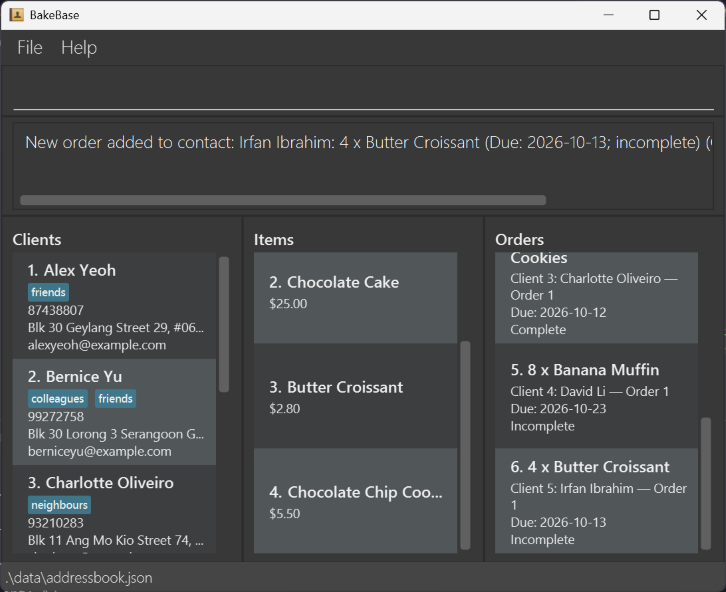
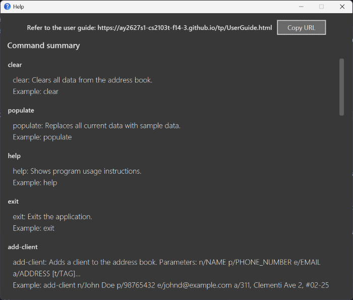

BakeBase is a **desktop application for home bakers to manage clients, bakery items, and orders, optimized for use through a Command Line Interface (CLI)** while retaining the benefits of a Graphical User Interface (GUI). If you type quickly, BakeBase can help you manage your home bakery business faster than traditional GUI applications.

Your **bakery book** is the collection of clients, bakery items, and orders stored in BakeBase.

* Table of Contents
{:toc}

--------------------------------------------------------------------------------------------------------------------

## Quick start

1. Ensure that Java `25` or later is installed on your computer. 
   **Mac users:** Ensure you have the precise JDK version prescribed [here](https://se-education.org/guides/tutorials/javaInstallationMac.html).

1. Download [BakeBase-v1.5.jar](https://github.com/AY2627S1-CS2103T-F14-3/tp/releases/download/v1.5/BakeBase-v1.5.jar) from the [BakeBase v1.5 release](https://github.com/AY2627S1-CS2103T-F14-3/tp/releases/tag/v1.5).

1. Copy the file to the folder you want to use as the _home folder_ for BakeBase.

1. Open a terminal, `cd` to the folder containing the JAR file, and run `java -jar BakeBase-v1.5.jar`. 
   A GUI similar to the one below should appear in a few seconds. Note how the app contains some sample data. 
   

1. Type a command in the command box and press Enter to execute it. For example, type **`help`** and press Enter to open the help window. 
   Some example commands you can try:

   * `list-clients` : Lists all contacts.

   * `add-client n/John Doe p/98765432 e/johnd@example.com a/John street, block 123, #01-01` : Adds a contact named `John Doe` to the bakery book.

   * `delete-client 3` : Deletes the 3rd contact shown in the current list.

   * `add-item n/Banana Muffin p/5.99` : Adds a bakery item named `Banana Muffin` to the bakery book.

   * `clear` : Shows a warning. Use `clear confirm` to delete all clients, bakery items, and orders.

   * `exit` : Exits the app.

2. Refer to the [Features](#features) section below for details of each command.

--------------------------------------------------------------------------------------------------------------------

## Features

**:information_source: Notes about the command format:** 

* Words in `UPPER_CASE` are the parameters to be supplied by the user. 
  For example, in `add-client n/NAME`, replace `NAME` with a value such as `John Doe`.

* Items in square brackets are optional. 
  For example, `n/NAME [t/TAG]` can be used as `n/John Doe t/friend` or as `n/John Doe`.

* Items followed by `…`​ can appear zero or more times. 
  For example, `[t/TAG]…​` may be omitted, or written as `t/friend` or `t/friend t/family`.

* Parameters can be in any order. 
  For example, if the command specifies `n/NAME p/PHONE_NUMBER`, `p/PHONE_NUMBER n/NAME` is also acceptable.

* Extraneous parameters for commands that take no parameters, such as `help`, `list-clients`, `list-items`, `populate`, and `exit`, are ignored. 
  For example, `help 123` is interpreted as `help`.

* If you are using a PDF version of this document, be careful when copying and pasting commands that span multiple lines as space characters surrounding line-breaks may be omitted when copied over to the application.

### Client commands

#### Adding a client: `add-client`

Adds a client to the bakery book.

Format: `add-client n/NAME p/PHONE_NUMBER e/EMAIL a/ADDRESS [t/TAG]…​`

:bulb: **Tip:**
A client can have any number of tags, including zero.

Examples:
* `add-client n/John Doe p/98765432 e/johnd@example.com a/John street, block 123, #01-01`
* `add-client n/Betsy Crowe t/friend e/betsycrowe@example.com a/Newgate Prison p/1234567 t/criminal`

#### Deleting a client: `delete-client`

Deletes the specified client from the bakery book. If the client has orders, delete those orders first.

Format: `delete-client INDEX`

* Deletes the client at the specified `INDEX`.
* The index refers to the index number shown in the displayed client list.
* The index **must be a positive integer** 1, 2, 3, …​

Examples:
* `list-clients` followed by `delete-client 2` deletes the 2nd client in the bakery book.
* `find-clients Betsy` followed by `delete-client 1` deletes the 1st client in the results of the `find-clients` command.

#### Editing a client: `edit-client`

Edits an existing client in the bakery book. The client's existing orders are retained.

Format: `edit-client INDEX [n/NAME] [p/PHONE] [e/EMAIL] [a/ADDRESS] [t/TAG]…​`

* Edits the client at the specified `INDEX`. The index refers to the index number shown in the displayed client list. The index **must be a positive integer** 1, 2, 3, …​
* At least one of the optional fields must be provided.
* Existing values will be updated to the input values.
* When editing tags, all of the client's existing tags are removed; adding tags is not cumulative.
* To remove all of a client's tags, enter `t/` without a tag after it.

Examples:
*  `edit-client 1 p/91234567 e/johndoe@example.com` Edits the phone number and email address of the 1st client to be `91234567` and `johndoe@example.com` respectively.
*  `edit-client 2 n/Betsy Crower t/` Edits the name of the 2nd client to be `Betsy Crower` and clears all existing tags.

#### Listing all clients: `list-clients`

Shows a list of all clients in the bakery book.

Format: `list-clients`

#### Locating clients by name: `find-clients`

Finds clients whose names contain any of the given keywords.

Format: `find-clients KEYWORD [MORE_KEYWORDS]`

* The search is case-insensitive; for example, `hans` matches `Hans`.
* Keyword order does not matter; for example, `Hans Bo` matches `Bo Hans`.
* The search considers only names.
* Only full words match; for example, `Han` does not match `Hans`.
* Clients matching at least one keyword are returned (an `OR` search); for example, `Hans Bo` returns `Hans Gruber` and `Bo Yang`.

Examples:
* `find-clients John` returns `john` and `John Doe`
* `find-clients alex david` returns `Alex Yeoh`, `David Li` 
  

### Bakery item commands

#### Adding a bakery item: `add-item`

Adds the specified bakery item to the bakery book.

Format: `add-item n/ITEM_NAME p/PRICE_DOLLARS`

* Adds the bakery item with the leading and trailing whitespace removed from `ITEM_NAME`. The name must not be blank and must contain only printable ASCII characters.
* Printable ASCII is defined as the set of:
  * lowercase letters `a`–`z` and uppercase letters `A`-`Z`
  * digits `0`-`9`
  * the ordinary space character
  * the special characters ``!"#$%&'()*+,-./:;<=>?@[\]^_`{|}~``
* `/` can appear in an item name. However, `n/` and `p/` preceded by whitespace are interpreted as command prefixes and cannot be included literally in an item name. For example, `Cake/Cream` and `Cake / Cream` are accepted, but `Cake n/Cream` and `Cake p/Special` are not. There is no quoting or escaping syntax for these reserved sequences.
* Duplicate items are rejected. An item is a duplicate if they have the same item name after trimming, removing extra whitespace and converting to uppercase.
* `PRICE_DOLLARS` must be non-negative and can have the format `D`, `D.`, `D.c`, `D.cc`, `.c`, or `.cc`, where `D` represents one or more digits and `c` represents one digit.

Examples:
* `add-item n/Banana Muffin p/5.90`

#### Editing a bakery item: `edit-item`

Edits the name, price, or both fields of an existing bakery item. Existing orders for the item are retained; if the item is renamed, its order cards show the new name.

Format: `edit-item INDEX [n/ITEM_NAME] [p/PRICE]`

* Edits the bakery item at the specified `INDEX` in the displayed bakery item list.
* The index **must be a positive integer** 1, 2, 3, …​ and must not exceed the number of displayed bakery items.
* At least one of `n/ITEM_NAME` or `p/PRICE` must be provided. An omitted field is left unchanged.
* `ITEM_NAME` and `PRICE` follow the same validation rules as the [`add-item`](#adding-a-bakery-item-add-item) command.
* The edit is rejected without changing any data if the new item name duplicates another bakery item's normalized name. Letter case and repeated whitespace do not distinguish item names.
* Each of the `n/` and `p/` prefixes can appear at most once.

Examples:
* `edit-item 1 n/Blueberry Muffin` changes only the name of the 1st displayed bakery item.
* `edit-item 2 p/6.50` changes only the price of the 2nd displayed bakery item.
* `edit-item 3 n/Chocolate Tart p/18.90` changes both the name and price of the 3rd displayed bakery item.

#### Deleting a bakery item: `delete-item`

Deletes the specified bakery item from the bakery book. If orders reference this item, delete those orders first.

Format: `delete-item INDEX`

* Deletes the bakery item at the specified `INDEX`.
* The index refers to the index number shown in the displayed bakery item list.
* The index **must be a positive integer** 1, 2, 3, …​

Examples:
* `delete-item 1` deletes the 1st bakery item in the displayed bakery item list.

#### Finding bakery items by name: `find-items`

Format: `find-items KEYWORD [MORE_KEYWORDS]...`

Matches any supplied keyword against whole words in item names, case-insensitively.
For example, `find-items BANANA chocolate` finds Banana Muffin and Chocolate Muffin;
`find-items muff` does not match Muffin. An empty search is rejected.
Use `list-items` to restore all items. The item indices for `add-order`, `edit-order`, `edit-item`,
and `delete-item` refer to this displayed list. Searching does not change stored data.

#### Listing all bakery items: `list-items`

Shows all bakery items in the item panel, with their index, name, and price.

Format: `list-items`

Like `list-clients`, this command ignores extra arguments. It does not change the displayed client list.
The displayed item indices can be used with `edit-item`, `delete-item`, `add-order`, and `edit-order`.

### Order commands

Order commands use the displayed client and item lists. Create the client and bakery item before adding an order.

* `CONTACT_INDEX` is the client's index in the displayed client list. Use `list-clients` to show all clients after a search.
* `ITEM_INDEX` is the item's index in the displayed bakery item list.
* `ORDER_INDEX` is the order's position within that client's own orders, as shown on the order card. It is not the row number in the complete order list.
* Indices must be positive integers. Invalid indices or input fields leave existing data unchanged.

#### Adding an order: `add-order`

Adds a new incomplete order for an existing client and bakery item.

Format: `add-order CONTACT_INDEX i/ITEM_INDEX q/QUANTITY d/DEADLINE`

* Required `i/`, `q/`, and `d/` fields may appear in any order.
* `QUANTITY` must be a whole number from 1 to 9,999.
* `DEADLINE` must be a real calendar date in `YYYY-MM-DD` format. Past dates are accepted for record-keeping.
* Identical repeat orders are allowed and can be managed separately.
* The success message includes the new order's index within the client's orders.

Example:
* `add-order 1 i/1 q/5 d/2026-10-15` adds an order for five units of item 1 to client 1.

#### Editing an order: `edit-order`

Corrects the selected order's item, quantity, deadline, or any combination of these fields.

Format: `edit-order CONTACT_INDEX o/ORDER_INDEX [i/ITEM_INDEX] [q/QUANTITY] [d/DEADLINE]`

* Provide at least one of `i/`, `q/`, or `d/`. Omitted fields keep their current values.
* Prefixes may appear in any order, but each may occur only once. Empty values are rejected.
* The client and optional item indices refer to their displayed lists. The order index refers to the
  client's full order list, including orders hidden by searches or completion filters.
* Quantities must be whole numbers from 1 to 9,999. Deadlines must be real calendar dates in
  `YYYY-MM-DD` format; past deadlines are accepted.
* The order retains its identity, client, completion status, and client-local number. Identical repeat
  orders remain separate. Use `mark-order-complete` or `unmark` to change completion status.
* Active searches, completion filters, and deadline sorting remain applied. An edited order may
  disappear from a search result or move within a sorted view; its client-local number stays the same.
* Success is reported after saving. A save failure restores data, filters, and sorting.
* `undo` reverses a successful edit. Supplying existing values reports unchanged details and retains
  the previous undo opportunity.

Examples:

* `edit-order 1 o/2 q/13` changes only the quantity of client 1's second order.
* `edit-order 1 o/2 i/1 q/5 d/2026-10-15` replaces all three editable fields.

#### Deleting an order: `delete-order`

Deletes the selected order from the specified client.

Format: `delete-order CONTACT_INDEX o/ORDER_INDEX`

* Deletes only the selected order; other orders, including identical repeat orders, are retained.
* Later order indices for that client shift down after deletion. Use the updated numbers shown on the cards.

Example:
* `delete-order 1 o/2` deletes client 1's second order.

#### Marking an order complete: `mark-order-complete` (alias: `mark`)

Marks the selected client order as complete.

Format: `mark-order-complete CONTACT_INDEX o/ORDER_INDEX` or `mark CONTACT_INDEX o/ORDER_INDEX`

Both forms use the same validation, save, and undo behavior.

* The order remains visible in the order panel.
* If the order is already complete, an error is shown and no data is changed.

Example:
* `mark 1 o/2` is the shorter equivalent of `mark-order-complete 1 o/2`.
* `mark-order-complete 1 o/2` marks client 1's second order complete.

#### Restoring an order to incomplete: `unmark`

Restores the selected completed order to incomplete.

Format: `unmark CONTACT_INDEX o/ORDER_INDEX`

* If the order is already incomplete, an error is shown and no data is changed.

Example:
* `unmark 1 o/2` restores client 1's second order to incomplete.

#### Finding orders by client or item name: `find-orders`

Format: `find-orders KEYWORD [MORE_KEYWORDS]...`

Matches any supplied keyword against whole words in either the client name or bakery item
name, case-insensitively. For example, `find-orders Alice muffin` shows Alice's orders and
all orders for muffins. Partial words do not match, and empty searches are rejected.
Use `list-orders` to restore all orders. Client and item searches remain unchanged.

The row number follows the search results, but each card retains its order number within
the client's full order list. Use the card's client index and order number for
`mark-order-complete`, `unmark`, `edit-order`, and `delete-order`, even when earlier orders are hidden.
If the client index is hidden, use `list-clients` to show it before acting.
Hidden orders remain stored and still prevent deletion of their client or item.
Searching replaces the previous order search or completion view and restores insertion order.

#### Listing all orders: `list-orders`

Order cards use **green** for completed orders, **gray** for incomplete orders due today
or later, and **red** for incomplete orders with a deadline before today's local date.
Completed orders remain green even after their deadline. Due today is not overdue.
Each status color alternates between darker and lighter shades on consecutive rows.
The cards retain their deadline and status text; overdue cards say `Incomplete (overdue)`.
Colors update when orders are marked or unmarked and within a second of a date change
while the app is running (or after it resumes from sleep).

Shows all orders in insertion order, including completed orders. Each card shows its position
in the order list, item, quantity, client name, that client's own order number, deadline, and completion status.

Format: `list-orders [by-deadline]`

* Leaves the displayed client and item lists unchanged.
* Clears the order search or completion view. Add `by-deadline` to show earliest deadlines first;
  omit it to restore insertion order. Unknown or additional arguments are rejected.
* Orders stay visible when clients are filtered with `find-clients`.
* Row numbers refer to this complete order list. The client line shows the client's displayed
  index and the order number within that client's own orders, for example `Client 2: Bernice Yu — Order 1`.
  Existing order commands take these two indices, for example `delete-order 2 o/1`.
  Client indices update with the displayed client list. If a client is hidden by a search,
  their name and order number remain visible, but their client index is omitted.
* Adding, deleting, or marking an order updates the panel automatically. Deleting an order
  renumbers the remaining rows in the order panel.

#### Listing completed or incomplete orders: `list-complete-orders`, `list-incomplete-orders`

Format: `list-complete-orders [by-deadline]` or `list-incomplete-orders [by-deadline]`

Shows only completed orders or only incomplete orders, respectively, in insertion order.
Incomplete orders include both overdue orders and orders due today or later.

* Replaces the previous order search or completion view. For example, `find-orders Alice`
  followed by `list-incomplete-orders` shows all incomplete orders across all clients.
* Leaves the displayed client and item lists unchanged.
* Add `by-deadline` to show earliest deadlines first, for example `list-complete-orders by-deadline`.
  Omit it to restore insertion order. Unknown or additional arguments are rejected.
* Updates automatically: marking an order complete removes it from the incomplete view;
  running `unmark` removes an order from the completed view.
* Each card retains its order number within the client's full order list. Use the card's
  client index and order number for order commands, even when earlier orders are hidden.
* Use `list-orders` to show all orders again. These commands do not change stored orders or undo history.

For all three order-list commands, orders with the same deadline retain their insertion order.
Sorting changes only the displayed rows; stored orders and client-local order numbers stay unchanged.
New orders appear in deadline order while sorting is active. Running `find-orders`, `undo`,
`populate`, or `clear confirm` restores insertion order; sorting is not saved between app sessions.

### General commands

#### Undoing the last data change: `undo`

Type `undo` in the command input to reverse the last successfully saved data change.

* Supports adding, editing, or deleting clients/items, adding, editing, or deleting orders, marking/unmarking orders, `clear confirm`, and `populate`. Running `clear` without confirmation only shows a warning and does not replace undo history.
* Only one change can be undone. A new saved data change replaces the previous undo opportunity. There is no redo.
* Listing, searching, help, failed commands, and edits that leave data unchanged do not replace the undo opportunity.
* Undo restores linked clients, items, and orders together. It shows all clients and items again, so use the refreshed indices.
* If nothing can be undone, `undo` reports an error without changing data.
* If saving undo fails, the current data and displayed filters are restored, and you can retry.
* Undo history is cleared on restart; successfully restored data remains saved. Extra arguments are rejected.

Example: `delete-order 1 o/2` followed by `undo` restores the deleted order.

#### Recalling commands with Up and Down

While the command input has focus, press **Up** to recall the latest submitted command and press it again for older commands. Press **Down** to move toward newer commands. Moving past the newest command restores the unfinished text you typed before navigating.

* You can edit recalled text and press Enter to submit it. This does not change the original history entry.
* Navigation keeps the caret at the end of the recalled text and does not execute commands.
* Non-empty submissions, including commands that produce errors, are remembered. Empty submissions are ignored.
* At the oldest entry, further Up presses keep that entry. Down at the draft keeps the current input.
* History lasts only for the current application session. Modified arrow shortcuts keep their normal behavior.

#### Viewing help: `help`

Shows a message explaining how to access the help page, and a very brief summary of the commands.

If the Help window is already open, running `help`, using the `Help` menu, or pressing `F1` brings it into focus and restores it if minimized.

Format: `help`

#### Replacing all entries with sample data: `populate`

Replaces all current clients, bakery items, and orders with the default sample data.
This overwrites existing data; it does not append to it. The replacement is saved automatically.

Format: `populate`

* Loads 12 sample clients, 12 bakery items, and 24 orders, including completed and incomplete orders.
* Sample deadlines are relative to the day you run `populate`, with overdue, due-today, and upcoming orders.
* Resets client and item filters so all sample entries are displayed.
* Running it again replaces the data with a fresh sample book rather than adding duplicates.
* If saving fails, the previous data and filters are restored.

#### Clearing all entries: `clear`

Requires explicit confirmation before removing all clients, bakery items, and orders from the bakery book.

Format: `clear` or `clear confirm`

* `clear` shows a warning without changing or saving any data. The warning counts all clients, items, and orders in the book, including records hidden by searches. Counts reflect the current book, rather than only the displayed search results.
* To cancel, simply continue using other commands. There is no pending action or confirmation dialog.
* Only the exact, lowercase word `confirm` is accepted. Other arguments (for example, `clear yes` or `clear confirm extra`) are rejected without changing data.
* **`clear confirm` deletes all clients, items, and orders immediately.** It is an intentional, one-shot command for experienced users: you do not need to type `clear` first, and there is no additional confirmation prompt. All records are removed, including records hidden by searches. Review the command before pressing Enter, including when recalling it from command history.
* If saving fails, the previous data and displayed filters are restored. You can retry the confirmed command.

##### Interaction with single-step undo

Use the `undo` command to recover the last saved data change, including a confirmed clear.

Confirmation prevents accidental deletion; undo allows recovery after a confirmed deletion:

Action | Effect on data and undo
-------|-----------------------
`clear` | Shows the warning without changing data or replacing the previous undo opportunity.
Invalid input such as `clear yes` | Is rejected without changing data or undo history.
`clear confirm` on a non-empty book | Deletes all records and replaces the undo snapshot with the complete book from before deletion.
`undo` after confirmed clearing | Restores clients, items, linked orders, and completion statuses, shows all lists, and consumes the single undo snapshot.
Confirmed clearing that fails to save | Restores data and displayed filters; the earlier undo opportunity remains available.
`clear confirm` on an already empty book | Does not change data, so it does not replace an existing undo snapshot.

For example, `edit-item 1 p/12`, then `clear`, then `undo` reverses the item edit: the warning did not change data. By contrast, `clear confirm`, then `undo` restores the deleted book.

Only the last successful data change is recoverable. A subsequent data change replaces the snapshot, and restarting the application discards undo history. There is no redo. Undoing a clear cannot also undo an earlier edit; keep backups for longer-term recovery.

#### Exiting the program: `exit`

Exits the program.

Format: `exit`

## Data storage

### Saving the data

BakeBase automatically saves data after every command. You do not need to save manually.

Clients, bakery items, orders, and completion statuses are saved together. A successful change is reported only after saving succeeds. If saving fails, an error is shown and the previous in-memory data and displayed filters are restored.

### Editing the data file

BakeBase data is saved automatically as a JSON file `[JAR file location]/data/addressbook.json`. Advanced users are welcome to update data directly by editing that data file.

:exclamation: **Caution:**
If your changes make the data file invalid, BakeBase starts with an empty bakery book at the next run. The invalid file remains on disk until you run a command (BakeBase saves after every command). Still, we recommend backing up the file before editing it. 
Furthermore, certain edits can cause BakeBase to behave in unexpected ways (e.g., if a value entered is outside of the acceptable range). Therefore, edit the data file only if you are confident that you can update it correctly.

Existing AddressBook Level 3 (AB3) files remain supported. Orders refer to clients and bakery items by name in the file. If you manually rename one, update its order references as well. Keep each order's UUID unique and use valid quantities, dates, and completion statuses. Incorrect edits can prevent loading and cause data loss, as with AB3; back up the file before editing it.

### Archiving data files `[coming in v2.0]`

_Details coming soon ..._

--------------------------------------------------------------------------------------------------------------------

## FAQ

**Q**: How do I transfer my data to another computer? 
**A**: Install the app on the other computer and overwrite the data file it creates with the data file from your previous BakeBase home folder.

--------------------------------------------------------------------------------------------------------------------

## Known issues

1. **When using multiple screens**, if you move the application to a secondary screen, and later switch to using only the primary screen, the GUI will open off-screen. The remedy is to delete the `preferences.json` file created by the application before running the application again.

--------------------------------------------------------------------------------------------------------------------

## Command summary

### Client commands

Action | Format, Examples
--------|------------------
**Add client** | `add-client n/NAME p/PHONE_NUMBER e/EMAIL a/ADDRESS [t/TAG]…​` e.g., `add-client n/James Ho p/22224444 e/jamesho@example.com a/123, Clementi Rd, 1234665 t/friend`
**Delete client** | `delete-client INDEX` e.g., `delete-client 3`
**Edit client** | `edit-client INDEX [n/NAME] [p/PHONE] [e/EMAIL] [a/ADDRESS] [t/TAG]…​` e.g., `edit-client 2 n/James Lee e/jameslee@example.com`
**List clients** | `list-clients`
**Find clients** | `find-clients KEYWORD [MORE_KEYWORDS]` e.g., `find-clients James Jake`

### Bakery item commands

Action | Format, Examples
--------|------------------
**Add bakery item** | `add-item n/ITEM_NAME p/PRICE_DOLLARS` e.g., `add-item n/Banana Muffin p/5.99`
**Edit bakery item** | `edit-item INDEX [n/ITEM_NAME] [p/PRICE]` e.g., `edit-item 2 n/Blueberry Muffin p/6.50`
**Delete bakery item** | `delete-item INDEX` e.g., `delete-item 3`
**Find bakery items** | `find-items KEYWORD [MORE_KEYWORDS]...`
**List bakery items** | `list-items`

### Order commands

Action | Format, Examples
--------|------------------
**Edit order** | `edit-order CONTACT_INDEX o/ORDER_INDEX [i/ITEM_INDEX] [q/QUANTITY] [d/DEADLINE]` e.g., `edit-order 1 o/2 q/13`
**Add order** | `add-order CONTACT_INDEX i/ITEM_INDEX q/QUANTITY d/DEADLINE` e.g., `add-order 1 i/2 q/5 d/2026-10-15`
**Delete order** | `delete-order CONTACT_INDEX o/ORDER_INDEX` e.g., `delete-order 1 o/2`
**Mark order complete** | `mark-order-complete CONTACT_INDEX o/ORDER_INDEX` or `mark CONTACT_INDEX o/ORDER_INDEX` e.g., `mark-order-complete 1 o/2`
**Restore order to incomplete** | `unmark CONTACT_INDEX o/ORDER_INDEX` e.g., `unmark 1 o/2`
**List orders** | `list-orders [by-deadline]`
**List completed orders** | `list-complete-orders [by-deadline]`
**List incomplete orders** | `list-incomplete-orders [by-deadline]`
**Find orders** | `find-orders KEYWORD [MORE_KEYWORDS]...`

### General commands

Action | Format
--------|-------
**Help** | `help`
**Undo last data change** | `undo`
**Populate sample data** | `populate`
**Clear all data** | `clear` to show the warning and counts; `clear confirm` to delete immediately without another prompt
**Exit** | `exit`
